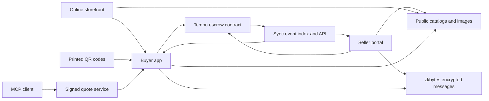

<div align="center">
  

# Picomart

**Sell online and offline.**


</div>

<div align="center">

Create your catalog, share an online storefront, and print QR codes for products, counters, flyers, or events. Customers browse, order, and pay from their phones.

**One catalog. Two ways to reach your customers.**


[Buyer app](picomart-frontend/README.md) | [Seller portal](picomart-seller/README.md) | [Smart contract](picomart-smartcontract/README.md) | [Local setup](#run-locally)

</div>

## One catalog. Online and offline sales.

Picomart gives sellers two ways to reach customers from the same catalog:

- **Sell online:** Give customers a storefront where they can browse your products and open checkout. Share its link on social media, in messages, or on your website.
- **Sell in person:** Place printed QR codes on products, packaging, counters, or flyers. Customers scan to view products, build their cart, and order from their phones.

Both channels lead to the same buyer checkout and seller order management. Customers can collect products in a local cart and pay in PathUSD when they are ready.

**Payments secured by Tempo escrow. Order details protected with encryption.**

Order details and delivery updates are encrypted in the browser and stored through zkbytes. Public catalogs and images are served through Bunny Storage and its CDN. Payment and order state live in the Picomart smart contract.

## How it works

1. **Create your catalog.** Add products, prices, and images, then publish the catalog.
2. **Choose how to sell.** Publish an online storefront, print catalog/product QR codes, or use both.
3. **Let customers shop.** Customers browse the storefront or scan a printed code, then collect products in their cart.
4. **Take payment.** The buyer reviews the order and approves a PathUSD payment using the built-in wallet. Tempo holds the funds in escrow.
5. **Fulfill.** The seller decrypts the order and sends an encrypted delivery update.
6. **Settle.** The buyer confirms receipt and the contract releases payment. Cancellation, refund, and deadline paths handle other outcomes.

## Built for everyday commerce

| Capability | Implementation |
| --- | --- |
| Online storefronts | Share a merchant shop with product browsing and links to buyer checkout. |
| Compact printed QR codes | Short catalog/product identifiers plus a network profile digit. |
| Browser wallets | Create, import, protect, lock, and back up a built-in wallet. |
| Stablecoin payments | PathUSD amounts use exact six-decimal base units. |
| Escrow | Catalog registration, payment, fulfillment, confirmation, refunds, and deadlines. |
| Private messaging | zkbytes identities and encrypted buyer/seller envelopes with contract commitments. |
| Catalog delivery | Signed storage uploads, public CDN delivery, and Sync resolution. |
| Merchant storefronts | Maintained shop template, generated revisions, previews, publication, and rollback. |
| Agent ordering | MCP prepares signed quote handoffs; the buyer approves payment in the browser. |

Wallets use EVM addresses. Network selection belongs in Settings. Mainnet is displayed as unavailable until its deployment and configuration are enabled. External-wallet support is not enabled in the current application.

## Architecture



The contract records public commerce state and message commitments. Plaintext delivery details remain outside the contract. Sync indexes events for fast history and catalog lookup; clients verify encrypted message integrity during recovery.

## Repository

| Project | Purpose |
| --- | --- |
| [Buyer](picomart-frontend/README.md) | Checkout from storefronts or printed QR codes, local cart, wallet, and orders. |
| [Seller](picomart-seller/README.md) | Catalogs, storefront management, printable QR codes, wallet popup, and fulfillment. |
| [Smart contract](picomart-smartcontract/README.md) | Solidity escrow and lifecycle rules. |
| [Order protocol](picomart-order-protocol/README.md) | Shared configuration, ABI, schemas, compact links, and agent handoff. |
| [Sync](picomart-sync/README.md) | Tempo event projection, catalog resolution, and storage uploads. |
| [Promo](picomart-promo/README.md) | Browsable and printable catalogs. |
| [Storefront template](picomart-storefront-template/README.md) | Self-contained merchant shop starter. |
| [Storefront builder](picomart-storefront-builder/README.md) | Generation, private previews, publication, and rollback. |
| [MCP](picomart-mcp/README.md) | Agent order preparation and status tools. |
| [Quote service](picomart-x402-server/README.md) | Signed quotes and Tempo payment-evidence verification. |
| [Storefront harness](tools/storefront-harness/README.md) | Isolated build and publication validation. |

## Release versions

Before committing and pushing a release, bump the version of each app or shared package whose behavior changed. Use a patch bump for fixes, a minor bump for compatible features, and a major bump for breaking changes. Keep `package.json` and the root version fields in `package-lock.json` synchronized; a version-only update should not change dependencies. Packages without changes can keep their current version.

When changing the storefront template, also refresh the builder's source digest and packaged template, and deploy through the **Deploy storefront builder** workflow so the release receives a matching validated checkpoint. Confirm CI and the affected deployments succeed after pushing.

## Run locally

Use **Node.js 24.11 or later**. Each project installs independently from its lockfile. Start these services in separate terminals.

### Sync

```powershell
cd picomart-sync
npm ci
Copy-Item .env.example .env
npm run dev
```

Sync listens on `http://localhost:3000`. Catalog publishing requires its Bunny storage zone, access key, regional endpoint, and public CDN origin, with `BUNNY_UPLOAD_ENABLED=true`.

### Buyer

```powershell
cd picomart-frontend
npm ci
Copy-Item .env.example .env.local
npm run dev -- --port 5173
```

Set these public values in `.env.local` before starting:

```dotenv
VITE_TEMPO_COMMERCE_ENABLED=true
VITE_PICOMART_SYNC_ORIGIN=http://localhost:3000
VITE_ZKBYTES_API_ORIGIN=<your-zkbytes-api-origin>
VITE_ZKBYTES_DOWNLOAD_ORIGIN=<your-zkbytes-download-origin>
```

### Seller

```powershell
cd picomart-seller
npm ci
Copy-Item .env.example .env.local
npm run dev -- --port 5174
```

Use the same public Sync and zkbytes settings. Sync's default upload-origin allowlist includes the seller on port `5174`. Restart Vite after environment changes.

Create separate buyer and seller wallets, keep their backups, and fund them with the configured PathUSD token. Publish a seller catalog and try its QR link with the buyer app. To sell through an online storefront, configure the storefront builder described in its package README. `/tempo-wallet` and `/tempo-contract` provide separate diagnostics.


More details....
